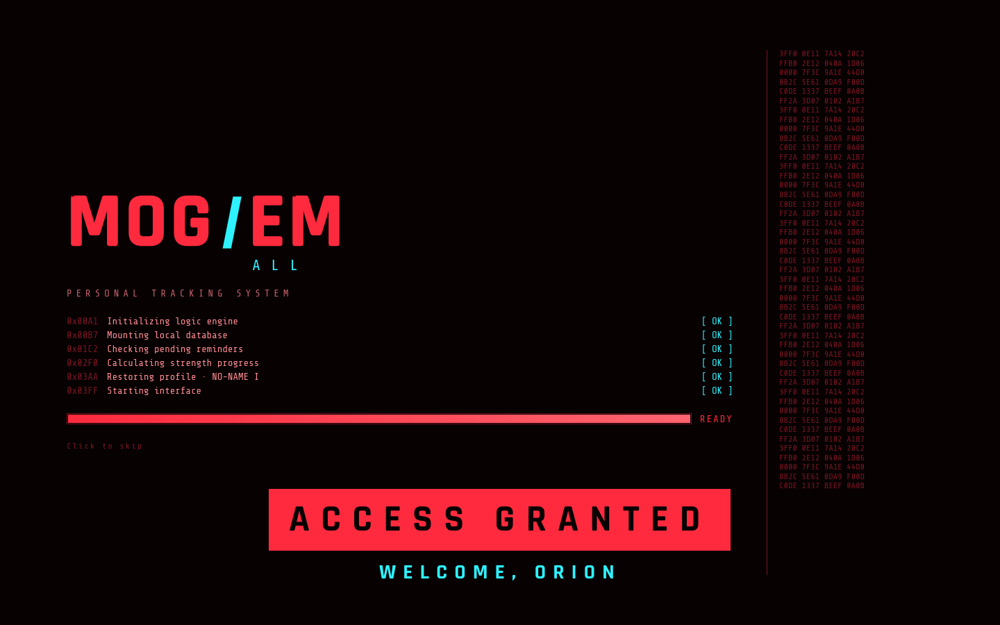
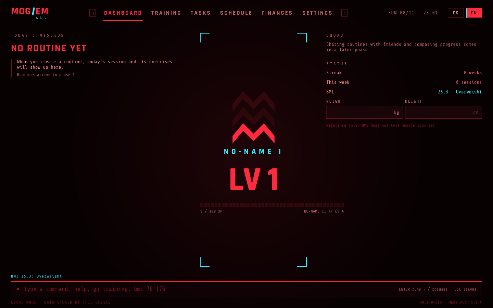

<div align="center">


<p>Tasks, schedule, finances and training in one desktop app with a terminal-style interface.<br>Written in Rust with Slint. Your data stays on your machine.</p>

<p>
<a href="LICENSE.md"></a>


</p>

<p>
<a href="#install">Install</a> ·
<a href="#usage">Usage</a> ·
<a href="#roadmap">Roadmap</a> ·
<a href="docs/RANKS.md">Ranks</a> ·
<a href="README.md">Español</a>
</p>


</div>

## What it is

mog 'em all puts in one place what you would normally track in four different apps: to-dos, schedule, spending and training. The training side gets the most attention: you build routines by weekday (say, Monday is chest day), log each set during the session with its type (normal, warm-up, dropset, superset or to failure), and a rest timer starts on its own. Every session earns XP, you level up by staying consistent, and each lift gets a strength class from E to S based on your bodyweight. Later on you will be able to share routines with friends and compare how you both progress.

You can drive it with the keyboard or the mouse. There is a command line at the bottom of the screen for quick actions (`bmi 78.5 176`, `go training`), and Q and E move between tabs.

> [!NOTE]
> This is early development. The interface, ranks, BMI and training (routines, sessions, sets and rest) work. Tasks, schedule and finances arrive in phases. See the [roadmap](#roadmap).

<table>
<tr>
<td width="50%"></td>
<td width="50%"></td>
</tr>
<tr>
<td align="center">Boot screen</td>
<td align="center">Dashboard</td>
</tr>
</table>

## Install

There are no releases yet, so for now you build it from source. You need stable Rust 1.85 or newer.

```sh
git clone https://github.com/OrionTheProgrammer/mog-em-all.git
cd mog-em-all
cargo run --release -p mog-app
```

On Linux you also need the fontconfig and xkbcommon development libraries:

| Distribution | Command |
|---|---|
| Debian, Ubuntu | `sudo apt install libfontconfig1-dev libxkbcommon-dev` |
| Fedora | `sudo dnf install fontconfig-devel libxkbcommon-devel` |
| Arch, CachyOS | `sudo pacman -S fontconfig libxkbcommon` |

The language follows your system. To force one: `LANG=es_CL.UTF-8 cargo run -p mog-app`, or use the ES/EN switch in the top bar.

## Usage

### Keyboard

| Key | Action |
|---|---|
| <kbd>Q</kbd> / <kbd>E</kbd> | Previous / next tab |
| <kbd>/</kbd> | Jump to the command line |
| <kbd>Enter</kbd> | Run the command |
| <kbd>Esc</kbd> | Leave the command line |

### Commands

Commands work in English or Spanish. Case and accents don't matter.

| Command | What it does |
|---|---|
| `go <module>` or just `<module>` | Opens a module: `go training`, `finances` |
| `bmi <weight kg> <height cm>` | Calculates BMI and shows it on the dashboard: `bmi 78.5 176` |
| `lang es` / `lang en` | Switches the interface language |
| `help` | Lists the commands |

### Ranks

There are two separate measures. Your level goes up with XP from training regularly; since it measures effort, you can compete with friends even if your bodies are very different. Strength class is per lift and depends on how much you lift relative to your bodyweight. Levels are grouped into seven ranks, from No-Name to Psycho Mogger, and each rank has three divisions (I, II and III). Formulas and tables are in [docs/RANKS.md](docs/RANKS.md) (in Spanish).

## Roadmap

- [x] Phase 0 · Project base: HUD interface, boot screen, animated logo, ranks, BMI, command line, Spanish and English.
- [ ] Phase 1 · Local database (SQLite) ✓, workout logging ✓, level-up screen ✓, routines by weekday ✓, rest timer and set types ✓, profile, settings and rank animations.
- [ ] Phase 2 · Tasks and weekly schedule.
- [ ] Phase 3 · Finances: income, expenses, categories and budget.
- [ ] Phase 4 · Share routines without a server, through a file or a QR code.
- [ ] Phase 5 · Accounts, friends and compared progress, with optional sync.
- [ ] Android, after the first desktop release.

## How it's built

The code is split into three crates, and each responsibility lives in one place:

```
crates/
  mog-core/   rules and calculations: ranks, BMI, command parser. No UI dependency.
  mog-storage/ local database (SQLite): profile, exercises and sessions.
  mog-ui/     everything you see, in Slint: theme, components and screens.
  mog-app/    the executable: wires the other two together.
i18n/         translations (.po), embedded in the binary at build time.
tools/        scripts for translations and for recording the demo.
docs/         design notes and decisions (in Spanish).
```

Colors, fonts and animation timings are defined once in `crates/mog-ui/ui/theme/theme.slint`. UI text is written in English inside `@tr()`, and `tools/i18n.sh` keeps the translations in sync. More in [docs/ARCHITECTURE.md](docs/ARCHITECTURE.md) and [docs/I18N.md](docs/I18N.md).

## Contributing

Branches follow gitflow, versions follow semantic versioning and commits follow Conventional Commits. The details are in [CONTRIBUTING.md](CONTRIBUTING.md). External pull requests can't be accepted until a contributor license agreement (CLA) is in place. Bug reports and ideas in issues are welcome.

## License

The code is released under the [PolyForm Noncommercial 1.0.0](LICENSE.md). You can read it, change it and use it for personal, study or non-profit purposes. You can't sell it or use it in a commercial product or service. That makes it source-available rather than open source under the OSI definition. The author keeps the right to distribute it commercially and to accept donations.

## Credits

- [Slint](https://slint.dev), used under its Royalty-Free License 2.0.
- [Rajdhani](https://fonts.google.com/specimen/Rajdhani) by Indian Type Foundry and [Share Tech Mono](https://fonts.google.com/specimen/Share+Tech+Mono) by Carrois Type Design, both under the SIL Open Font License; the license texts are in `crates/mog-ui/ui/fonts/`.
- [chrono](https://crates.io/crates/chrono) for date and time.
