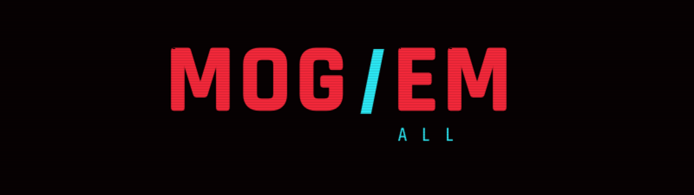
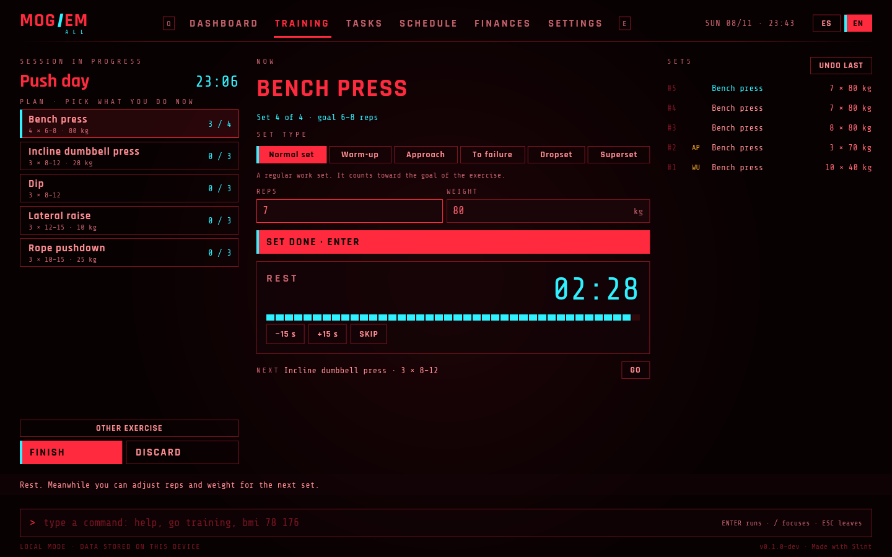
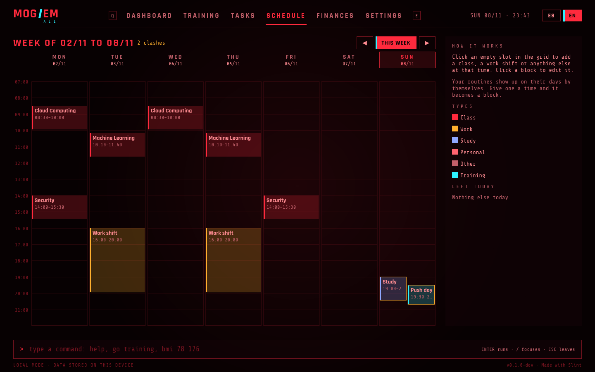
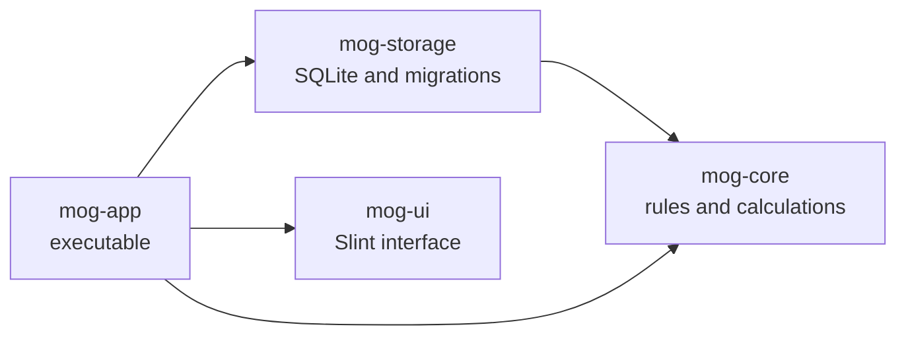

<div align="center">



<p>Training, tasks, schedule and finances in one desktop app with a terminal-style interface.<br>Written in Rust with Slint. Your data stays on your machine.</p>

<p>
<a href="https://github.com/OrionTheProgrammer/mog-em-all/actions/workflows/ci.yml"></a>
<a href="LICENSE.md"></a>


</p>

<p>
<a href="#install">Install</a> ·
<a href="#features">Features</a> ·
<a href="#usage">Usage</a> ·
<a href="#roadmap">Roadmap</a> ·
<a href="#development">Development</a> ·
<a href="README.md">Español</a>
</p>


</div>

## Contents

- [What it is](#what-it-is)
- [Features](#features)
- [Install](#install)
- [Usage](#usage)
- [Your data](#your-data)
- [Roadmap](#roadmap)
- [Architecture](#architecture)
- [Development](#development)
- [License](#license)
- [Credits](#credits)

## What it is

mog 'em all puts in one place what you would normally track across several apps: training, to-dos, schedule and spending. Training is the first part that is done. You build routines by weekday, log every set during the session, and the app keeps track of your progress: records, streaks, level and a strength class per lift.

It works offline and without an account. You can use it with the mouse or the keyboard, and there is a command line for quick actions.

> [!NOTE]
> This is in development (`0.1.0-dev`). Training, the schedule, ranks and BMI work. Tasks, notifications and finances come in the next phases; see the [roadmap](#roadmap).

## Features



### Training

- **Routines by weekday.** Each routine is assigned to one or more days (say, Monday is chest day), and today's shows up at the top so you can start it with one click.
- **Targets per exercise.** Sets, rep range, weight and rest. When you add an exercise, its starting target depends on the exercise: a compound lift starts at 6–8 reps with a long rest, an isolation move at 10–15 with a short one.
- **A catalog of 104 exercises.** Each one knows which muscles it works, what equipment it needs and how it is measured (weight, bodyweight or time). Search in English or Spanish and filter by muscle. You can also add your own.
- **Set types.** Normal, warm-up, approach, to failure, dropset or superset. Warm-up and approach sets don't count toward the target, records or volume.
- **Automatic rest timer.** Logging a set starts a countdown with that routine's rest time, adjustable by ±15 s. Dropsets and supersets skip the rest.
- **The app walks you through it.** It suggests weight and reps from your last set or the target, moves to the next exercise when you hit the target, and a bar at the bottom tells you what to do next.
- **Sessions survive a restart.** If you close the app mid-workout, it picks up where you left off.

### Progress

- **Level and rank.** Every finished session earns XP based on duration, records and your streak of completed weeks. There are seven ranks, from No-Name to Psycho Mogger, each with divisions I, II and III.
- **Records.** Compared against the estimated 1RM of your best earlier set on each exercise.
- **Strength class.** From E to S on the main lifts (squat, bench, deadlift, overhead press, row and pull-up), based on how much you lift relative to your bodyweight. Formulas are in [docs/RANKS.md](docs/RANKS.md) (in Spanish).
- **End-of-session screen.** Summary, new records and the XP breakdown line by line while the level goes up.

### Schedule

- **Your week in an hourly grid,** with classes, work shifts or anything else, repeating every week or happening once.
- **Your routines show up on their own** on their days. Give a routine a time and it becomes one more block.
- **Clashes are visible:** overlapping blocks sit side by side and get flagged.
- **Click an empty slot** to add something at that time, click a block to edit it.
- **The dashboard** shows today's routine, ready to start, and what's left of your day.



### Interface

- **HUD-style interface** with an animated boot screen, tabs you move through with <kbd>Q</kbd> and <kbd>E</kbd>, and a command line in English or Spanish.
- **English and Spanish,** with a switch in the top bar. The starting language follows your system.

<table>
<tr>
<td width="50%"></td>
<td width="50%"></td>
</tr>
<tr>
<td align="center">Boot screen</td>
<td align="center">Dashboard</td>
</tr>
</table>

## Install

There are no releases yet, so you build it from source. You need stable Rust 1.85 or newer.

```sh
git clone https://github.com/OrionTheProgrammer/mog-em-all.git
cd mog-em-all
cargo run --release -p mog-app
```

On Linux you also need the fontconfig and xkbcommon development libraries:

| Distribution | Command |
|---|---|
| Debian, Ubuntu | `sudo apt install libfontconfig1-dev libxkbcommon-dev` |
| Fedora | `sudo dnf install fontconfig-devel libxkbcommon-devel` |
| Arch, CachyOS | `sudo pacman -S fontconfig libxkbcommon` |

SQLite is built into the program; there is nothing else to install.

## Usage

### Your first workout

1. Open the **TRAINING** tab.
2. Create a routine (bottom left), add exercises from the library and mark the days you do it.
3. On one of those days, press **START** at the top left.
4. Do the set, check reps and weight, and press <kbd>Enter</kbd>. The rest timer starts on its own.
5. When you're done, press **FINISH** to see your XP and level.

The tab shows these steps until you have done them, and the bar at the bottom tells you what comes next at every point.

### Keyboard

| Key | Action |
|---|---|
| <kbd>Q</kbd> / <kbd>E</kbd> | Previous / next tab |
| <kbd>/</kbd> | Jump to the command line |
| <kbd>Enter</kbd> | Log the set, or run the command |
| <kbd>Esc</kbd> | Leave the text field |

### Commands

Commands work in English or Spanish. Case and accents don't matter.

| Command | What it does |
|---|---|
| `go <module>` or just `<module>` | Opens a module: `go training`, `finances` |
| `bmi <weight kg> <height cm>` | Calculates BMI and shows it on the dashboard: `bmi 78.5 176` |
| `lang es` / `lang en` | Switches the interface language |
| `help` | Lists the commands |

## Your data

Everything is stored in an SQLite file on your machine:

| System | Path |
|---|---|
| Linux | `~/.local/share/mog-em-all/mog.db` |
| Windows | `%APPDATA%\mog-em-all\mog.db` |

The database schema is versioned. Before any update that changes it, the app saves a copy next to the original (`mog.db.v2-<date>.bak`). If you open your data with an older version of the app, it leaves it untouched and tells you to update. Details in [docs/DATABASE.md](docs/DATABASE.md) (in Spanish).

## Roadmap

- [x] Phase 0 · Project base: HUD interface, boot screen, animated logo, ranks, BMI, command line, English and Spanish.
- [ ] Phase 1 · Training
  - [x] Local database with a versioned schema
  - [x] Routines by weekday, sessions, set types and rest timer
  - [x] Exercise catalog and custom exercises
  - [x] End-of-session screen with level and records
  - [ ] Profile (weight, height, weekly goal) and settings
  - [ ] Rank-up animations
- [ ] Phase 2 · Schedule, tasks and notifications
  - [x] Weekly schedule with events and training days
  - [ ] Tasks with due dates, priority and repetition
  - [ ] Running in the system tray, with notifications
- [ ] Phase 3 · Finances: spending by group, fixed and informal income, budgets.
- [ ] Phase 4 · Share routines without a server, through a file or a QR code.
- [ ] Phase 5 · Accounts, friends and compared progress, with optional sync.
- [ ] Android, after the first desktop release.

## Architecture



| Crate | What it holds |
|---|---|
| `mog-core` | Ranks, XP, strength class, BMI, exercise catalog, set types, command parser. Plain Rust, no UI. |
| `mog-storage` | Profile, exercises, routines, sessions and sets in SQLite. Migrations with history, checksums and backups. |
| `mog-ui` | Everything you see: theme, components, screens and the state of each tab. |
| `mog-app` | Wires the other three together: opens the database, answers the interface, runs the clock and the boot screen. |

Colors, fonts and animation timings are defined once in `crates/mog-ui/ui/theme/theme.slint`. More in [docs/ARCHITECTURE.md](docs/ARCHITECTURE.md).

## Development

```sh
cargo test --workspace                         # logic and database tests
cargo clippy --workspace -- -D warnings        # lints
tools/i18n.sh                                  # sync translations
tools/gen_exercises.py                         # regenerate names from the catalog
tools/demo.sh en                               # record the README GIF and screenshots
```

- UI text is written in English inside `@tr()` and translated in `i18n/`. See [docs/I18N.md](docs/I18N.md).
- Adding an exercise is one row in `crates/mog-core/data/exercises.csv`.
- Branches follow gitflow, versions follow semantic versioning and commits follow Conventional Commits. The details are in [CONTRIBUTING.md](CONTRIBUTING.md).

External pull requests can't be accepted until a contributor license agreement (CLA) is in place. Bug reports and ideas in issues are welcome.

## License

The code is released under the [PolyForm Noncommercial 1.0.0](LICENSE.md). You can read it, change it and use it for personal, study or non-profit purposes. You can't sell it or use it in a commercial product or service. That makes it source-available rather than open source under the OSI definition. The author keeps the right to distribute it commercially and to accept donations.

## Credits

- [Slint](https://slint.dev), used under its Royalty-Free License 2.0.
- [rusqlite](https://crates.io/crates/rusqlite) with bundled SQLite, and [chrono](https://crates.io/crates/chrono) for dates.
- [Rajdhani](https://fonts.google.com/specimen/Rajdhani) by Indian Type Foundry and [Share Tech Mono](https://fonts.google.com/specimen/Share+Tech+Mono) by Carrois Type Design, both under the SIL Open Font License; the license texts are in `crates/mog-ui/ui/fonts/`.
