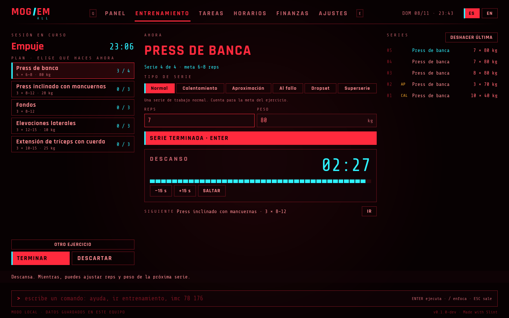
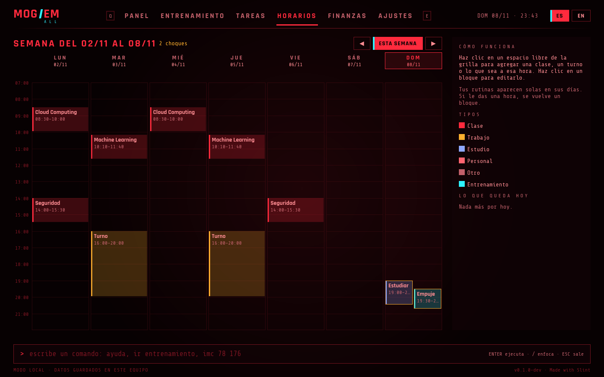
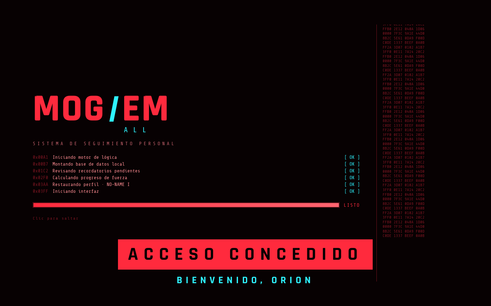
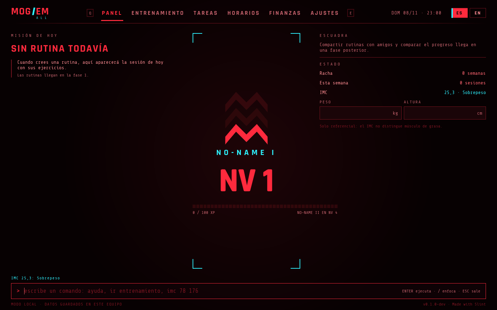
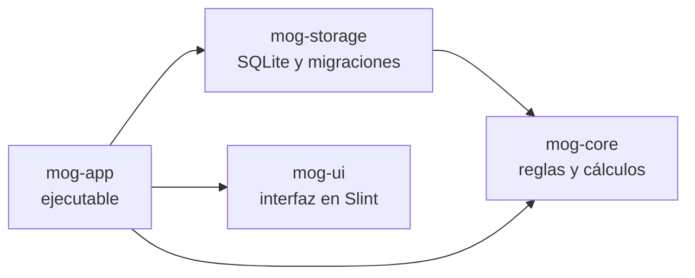

<div align="center">


<p>Entrenamiento, tareas, horarios y finanzas en una sola app de escritorio con interfaz de terminal.<br>Escrita en Rust con Slint. Tus datos se quedan en tu equipo.</p>

<p>
<a href="https://github.com/OrionTheProgrammer/mog-em-all/actions/workflows/ci.yml"></a>
<a href="LICENSE.md"></a>


</p>

<p>
<a href="#instalar">Instalar</a> ·
<a href="#funciones">Funciones</a> ·
<a href="#cómo-se-usa">Cómo se usa</a> ·
<a href="#hoja-de-ruta">Hoja de ruta</a> ·
<a href="#desarrollo">Desarrollo</a> ·
<a href="README.en.md">English</a>
</p>


</div>

## Contenido

- [Qué es](#qué-es)
- [Funciones](#funciones)
- [Instalar](#instalar)
- [Cómo se usa](#cómo-se-usa)
- [Tus datos](#tus-datos)
- [Hoja de ruta](#hoja-de-ruta)
- [Arquitectura](#arquitectura)
- [Desarrollo](#desarrollo)
- [Licencia](#licencia)
- [Créditos](#créditos)

## Qué es

mog 'em all junta en un solo lugar lo que normalmente anotas en varias apps: el entrenamiento, los pendientes, el horario y los gastos. Lo primero que está terminado es el entrenamiento. Armas tus rutinas por día de la semana, anotas cada serie durante la sesión y la app lleva la cuenta de tu progreso: récords, rachas, nivel y una clase de fuerza por ejercicio.

Funciona sin conexión y sin cuenta. Se maneja con mouse o con teclado, y tiene una línea de comandos para las acciones rápidas.

> [!NOTE]
> El proyecto está en desarrollo (`0.1.0-dev`). El entrenamiento, el horario, los rangos y el IMC funcionan. Tareas, notificaciones y finanzas llegan en las próximas fases; el detalle está en la [hoja de ruta](#hoja-de-ruta).

## Funciones



### Entrenamiento

- **Rutinas por día.** Cada rutina se asigna a uno o más días de la semana (por ejemplo, lunes pecho) y la del día aparece arriba para empezarla con un clic.
- **Metas por ejercicio.** Series, rango de repeticiones, peso y descanso. Al agregar un ejercicio, la meta inicial depende del ejercicio: un básico entra con 6–8 reps y descanso largo, un aislamiento con 10–15 y descanso corto.
- **Catálogo de 104 ejercicios.** Cada uno sabe qué músculos trabaja, con qué equipo se hace y cómo se mide (peso, peso corporal o tiempo). Se busca en español o inglés y se filtra por músculo. También puedes crear los tuyos.
- **Tipo de cada serie.** Normal, calentamiento, aproximación, al fallo, dropset o superserie. El calentamiento y la aproximación no cuentan para la meta, los récords ni el volumen.
- **Descanso automático.** Al anotar una serie arranca una cuenta regresiva con el descanso de esa rutina, ajustable en ±15 s. Los dropsets y superseries no inician descanso.
- **La app te lleva.** Propone peso y repeticiones a partir de tu serie anterior o de la meta, pasa sola al siguiente ejercicio cuando cumples la meta, y una barra abajo indica lo que toca hacer.
- **La sesión no se pierde.** Si cierras la app en medio de un entrenamiento, al abrirla sigue donde quedó.

### Progreso

- **Nivel y rango.** Cada sesión terminada da XP según la duración, los récords y tu racha de semanas cumplidas. Hay siete rangos, de No-Name a Psycho Mogger, cada uno con divisiones I, II y III.
- **Récords.** Se comparan con el 1RM estimado de tu mejor serie anterior en cada ejercicio.
- **Clase de fuerza.** De E a S en los básicos (sentadilla, banca, peso muerto, press militar, remo y dominadas), según cuánto levantas en relación con tu peso. Las fórmulas están en [docs/RANKS.md](docs/RANKS.md).
- **Pantalla de fin de sesión.** Resumen, récords nuevos y el detalle de la XP línea por línea mientras sube el nivel.

### Tareas

- **Se escriben como se piensan:** "Pagar arriendo mañana 18:00 !alta #casa" crea la tarea con fecha, hora, prioridad y etiqueta. Mientras escribes, ves cómo se entendió.
- **Agrupadas por cuándo vencen:** vencidas, hoy, mañana, esta semana, más adelante y sin fecha.
- **Repetición** diaria, semanal o mensual: al completar una, aparece la siguiente.
- **Completar se siente:** el corte del logo atraviesa la fila. Si te equivocas, se deshace desde "hechas hoy".

### Finanzas

- **Anotar un gasto es escribir una línea:** "12.500 almuerzo" va a Comida solo; "+20.000 venta polera" es un ingreso informal.
- **El mes de un vistazo:** ingresos fijos y otros, gastos, balance y cuánto del presupuesto llevas.
- **Presupuesto por grupo,** con aviso al 80 % y en rojo al pasarte.
- **Fijos de cada mes:** sueldo, arriendo y suscripciones aparecen pendientes y se registran con un clic.

### Horario

- **La semana en una grilla** por horas, con tus clases, turnos y cualquier otra cosa, que se repiten cada semana o pasan una sola vez.
- **Tus rutinas aparecen solas** en sus días. Si le das una hora a una rutina, se vuelve un bloque más.
- **Choques a la vista:** lo que se pisa se muestra lado a lado y marcado.
- **Clic en un espacio libre** para crear algo a esa hora, clic en un bloque para editarlo.
- **El panel principal** muestra la rutina de hoy, lista para empezar, y lo que queda en tu día.



### Interfaz

- **Primera vez:** un registro corto pide nombre, peso, altura y meta semanal. Todo se cambia después en AJUSTES, junto con el idioma, la moneda y la copia de seguridad.
- **Interfaz tipo HUD** con pantalla de carga animada, pestañas que se recorren con <kbd>Q</kbd> y <kbd>E</kbd>, y una línea de comandos en español o inglés.
- **Español e inglés,** con selector en la barra superior. El idioma inicial se toma del sistema.

<table>
<tr>
<td width="50%"></td>
<td width="50%"></td>
</tr>
<tr>
<td align="center">Pantalla de carga</td>
<td align="center">Panel principal</td>
</tr>
</table>

## Instalar

Todavía no hay versiones publicadas, así que se compila desde el código. Necesitas Rust estable 1.85 o superior.

```sh
git clone https://github.com/OrionTheProgrammer/mog-em-all.git
cd mog-em-all
cargo run --release -p mog-app
```

En Linux hacen falta las bibliotecas de desarrollo de fontconfig y xkbcommon:

| Distribución | Comando |
|---|---|
| Debian, Ubuntu | `sudo apt install libfontconfig1-dev libxkbcommon-dev` |
| Fedora | `sudo dnf install fontconfig-devel libxkbcommon-devel` |
| Arch, CachyOS | `sudo pacman -S fontconfig libxkbcommon` |

SQLite viene incluido en el programa; no hay que instalarlo aparte.

## Cómo se usa

### Primer entrenamiento

1. Abre la pestaña **ENTRENAMIENTO**.
2. Crea una rutina (abajo a la izquierda), agrégale ejercicios desde la biblioteca y marca los días en que la haces.
3. El día que toca, presiona **EMPEZAR** arriba a la izquierda.
4. Haz la serie, revisa reps y peso, y presiona <kbd>Enter</kbd>. El descanso arranca solo.
5. Al terminar, presiona **TERMINAR** para ver la XP y el nivel.

La pestaña muestra estos pasos mientras no los hayas hecho, y la barra inferior te dice qué sigue en cada momento.

### Teclado

| Tecla | Acción |
|---|---|
| <kbd>Q</kbd> / <kbd>E</kbd> | Pestaña anterior / siguiente |
| <kbd>/</kbd> | Ir a la línea de comandos |
| <kbd>Enter</kbd> | Anotar la serie, o ejecutar el comando |
| <kbd>Esc</kbd> | Salir del campo de texto |

### Comandos

Se escriben en español o en inglés. Las mayúsculas y las tildes no importan.

| Comando | Qué hace |
|---|---|
| `ir <módulo>` o solo `<módulo>` | Abre un módulo: `ir entrenamiento`, `finanzas` |
| `imc <peso kg> <altura cm>` | Calcula el IMC y lo deja en el panel: `imc 78,5 176` |
| `idioma es` / `idioma en` | Cambia el idioma de la interfaz |
| `ayuda` | Muestra la lista de comandos |

## Tus datos

Todo se guarda en un archivo SQLite en tu equipo:

| Sistema | Ruta |
|---|---|
| Linux | `~/.local/share/mog-em-all/mog.db` |
| Windows | `%APPDATA%\mog-em-all\mog.db` |

El esquema de la base está versionado. Antes de cada actualización que lo cambie, la app guarda una copia junto al original (`mog.db.v2-<fecha>.bak`). Si abres tus datos con una versión más vieja de la app, no los toca y te avisa que actualices. El detalle está en [docs/DATABASE.md](docs/DATABASE.md).

## Hoja de ruta

- [x] Fase 0 · Base del proyecto: interfaz HUD, pantalla de carga, logo animado, rangos, IMC, línea de comandos, español e inglés.
- [ ] Fase 1 · Entrenamiento
  - [x] Base de datos local con esquema versionado
  - [x] Rutinas por día, sesiones, tipos de serie y descanso
  - [x] Catálogo de ejercicios y ejercicios propios
  - [x] Pantalla de fin de sesión con nivel y récords
  - [x] Perfil (peso, altura, meta semanal) y ajustes
  - [ ] Animaciones de subida de rango
- [ ] Fase 2 · Horario, tareas y notificaciones
  - [x] Horario semanal con eventos y días de entrenamiento
  - [x] Tareas con fecha de entrega, prioridad y repetición
  - [ ] Segundo plano en la bandeja del sistema y notificaciones
- [x] Fase 3 · Finanzas: gastos por grupo, ingresos fijos e informales, presupuestos.
- [ ] Fase 4 · Compartir rutinas sin servidor, con un archivo o un código QR.
- [ ] Fase 5 · Cuentas, amigos y progreso comparado, con sincronización opcional.
- [ ] Android, después de la primera versión de escritorio.

## Arquitectura



| Crate | Qué tiene |
|---|---|
| `mog-core` | Rangos, XP, clase de fuerza, IMC, catálogo de ejercicios, tipos de serie, intérprete de comandos. Rust puro, sin interfaz. |
| `mog-storage` | Perfil, ejercicios, rutinas, sesiones y series en SQLite. Migraciones con historial, huella y copia de seguridad. |
| `mog-ui` | Todo lo que se ve: tema, componentes, pantallas y el estado de cada pestaña. |
| `mog-app` | Conecta las tres anteriores: abre la base, responde a la interfaz y lleva el reloj y la pantalla de carga. |

Colores, fuentes y tiempos de animación se definen una sola vez en `crates/mog-ui/ui/theme/theme.slint`. Más detalle en [docs/ARCHITECTURE.md](docs/ARCHITECTURE.md).

## Desarrollo

```sh
cargo test --workspace                         # tests de lógica y base de datos
cargo clippy --workspace -- -D warnings        # lint
tools/i18n.sh                                  # sincroniza traducciones
tools/gen_exercises.py                         # regenera nombres desde el catálogo
tools/demo.sh es                               # graba el GIF y las capturas del README
```

- Los textos de la interfaz se escriben en inglés dentro de `@tr()` y se traducen en `i18n/`. Ver [docs/I18N.md](docs/I18N.md).
- Para agregar ejercicios basta con una fila en `crates/mog-core/data/exercises.csv`.
- Las ramas siguen gitflow, las versiones usan versionado semántico y los commits siguen Conventional Commits. Todo está en [CONTRIBUTING.md](CONTRIBUTING.md).

Por ahora no se aceptan pull requests externos hasta que exista un acuerdo de contribución (CLA). Los reportes de errores y las ideas en *issues* son bienvenidos.

## Licencia

El código se publica bajo la [PolyForm Noncommercial 1.0.0](LICENSE.md). Puedes leerlo, modificarlo y usarlo para fines personales, de estudio o sin fines de lucro. No puedes venderlo ni usarlo en un producto o servicio comercial. Por eso es un proyecto de código disponible (*source-available*) y no de código abierto según la definición de la OSI. El autor conserva el derecho de distribuirlo comercialmente y de recibir donaciones.

## Créditos

- [Slint](https://slint.dev), usado bajo su licencia Royalty-Free 2.0.
- [rusqlite](https://crates.io/crates/rusqlite) con SQLite incluido, y [chrono](https://crates.io/crates/chrono) para fechas.
- [Rajdhani](https://fonts.google.com/specimen/Rajdhani), de Indian Type Foundry, y [Share Tech Mono](https://fonts.google.com/specimen/Share+Tech+Mono), de Carrois Type Design. Ambas bajo la SIL Open Font License; los textos de licencia están en `crates/mog-ui/ui/fonts/`.
